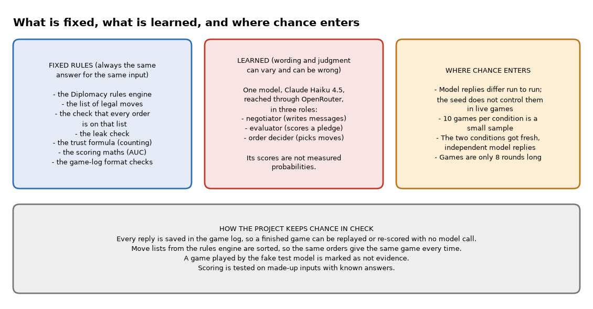
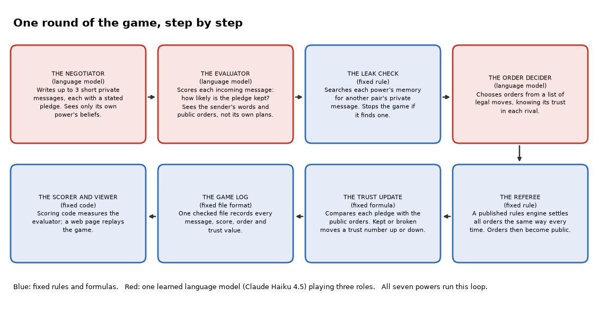
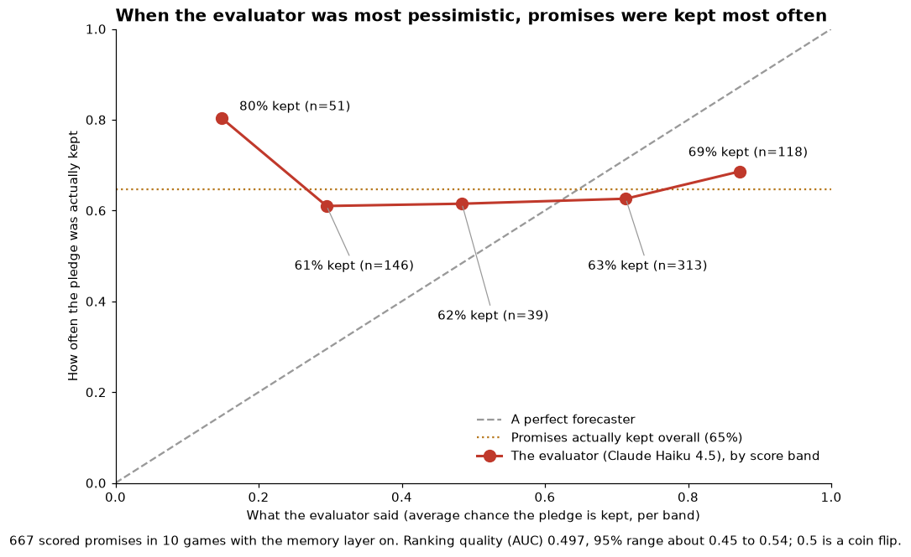
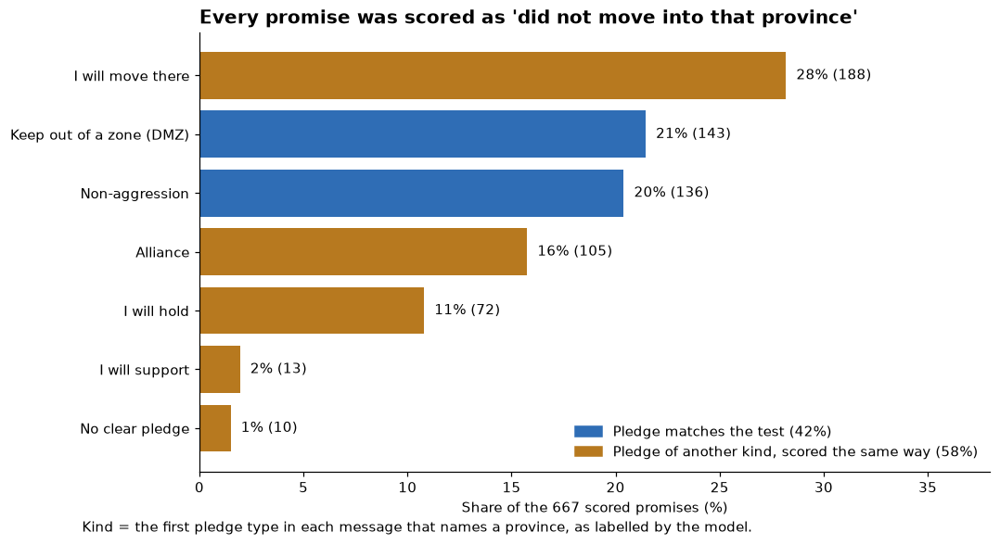

# Diplomacy

*A study in which seven AI players negotiate and fight over the board game Diplomacy, and a separate AI judge tries to say which of their promises will be kept. In this run the judge was no better than a coin flip at telling kept promises from broken ones, though a flaw in how the project scores promises may be hiding some of what it can do. Most of the machinery is fixed rules that always give the same answer; the players and the judge are one AI language model, whose output varies and can be wrong.*

Status: a finished research prototype, built on 10 and 11 September 2026 and deliberately stopped there. Code: https://github.com/PCSchmidt/Diplomacy (public, with two licences: AGPL-3.0-or-later (GNU Affero General Public License, which requires sharing source if you offer the software over a network) for the game engine, tests and file formats, and MIT (Massachusetts Institute of Technology, a permissive open-source licence) for the replay viewer). A static replay page is published at https://pcschmidt.github.io/Diplomacy/. Nothing shows that anyone but me has used it.

Here is the finding in plain words. Suppose you give the judge one promise that was kept and one that was broken, and ask which it thought more likely to be kept. A judge with real skill picks the kept one most of the time; a judge guessing picks it half the time. The score for this is called AUC (Area Under the Curve): the chance that a randomly chosen kept promise got a higher score than a randomly chosen broken one, from 0 to 1, where 0.5 is a coin flip. My judge scored 0.497 on 667 promises, with a 95% range of about 0.45 to 0.54. That is a coin flip. Its most pessimistic predictions were even backwards: when it said a promise had about a 15% chance of being kept, such promises were kept 80% of the time.

Two cautions come straight away. First, the scoring has a flaw that the project's own documents do not mention; it came out when the saved games were re-analysed for this guide. Every promise is scored as "I will not move my army into this province", yet only about 42% of the promises are that kind. A promise to move there is scored as broken when it is kept. That mismatch would be expected to blur the result toward 0.5, so the true skill may be higher than 0.497, though it cannot be shown to do only that. The results chapter shows what happens when only the promises that fit are scored. Second, the result is for one model, one set of instructions and short games, so it does not show that the approach cannot work.

## The game, the idea and how it was built

Diplomacy is a board game of 1901 Europe for seven players, with no dice. In each round the players talk privately, then write secret orders for their armies and fleets, and the orders are revealed and settled together by fixed rules. A round is one such cycle of talking, ordering and settling; the game's own software calls it a phase. Nothing forces a player to keep a promise, so the game is about deciding whom to believe.

I built this project, with AI coding agents writing almost all the code and me directing the scope, plan, architecture and preferences, to ask a narrow question. If each AI player keeps an explicit, inspectable record of how far it trusts every other player, does that help judge whether a given promise will be kept? Research calls this ability ToM (Theory of Mind): holding a belief about what someone else believes and intends. The idea that makes the project work is that trust is a statistic updated by plain arithmetic from what players actually did, while the AI is only allowed to judge, never to move the numbers.

The project has two kinds of number, and it helps to keep them apart. The trust number is arithmetic: after each round, the program compares what a player promised with what it then ordered, and the trust it holds for that rival goes up or down. The evaluator's guess is a forecast: a separate AI step reads each incoming message and says how likely it is that the promise will be kept. The trust number never uses the guess. The guess is what gets scored. My real subject is the measurement, built as a harness, meaning the test rig around the players that runs the games, records everything and scores the result.

Here is what is fixed and what is learned. A calculator is deterministic: the same input always gives the same answer. A weather forecast is probabilistic: a best guess that can be wrong. The rules engine, the list of legal moves, the check on every order, the leak check (which makes sure no private message reaches the wrong player), the trust formula and the scoring are calculators. Given the same orders, the engine plays the same game every time. The three jobs done by a language model are forecasts. The model is Claude Haiku 4.5, a small, low-cost language model from Anthropic that learned from huge amounts of text, reached through OpenRouter, a service that forwards one request format to many models. It can be wrong in ways nobody wrote down, and the "chance the promise is kept" it reports is a number it chose, not a measured probability.

Chance enters in three places. Model replies vary from run to run, and the seed (a starting number meant to make a program's random choices repeatable) does not control them. Ten games per condition is a small sample. And the games are short, eight rounds each. The project keeps chance in check by saving every model reply in the game log, so scoring and replay need no model, by marking any game played by a fake stand-in model as "not evidence", and by testing the scoring on made-up inputs with known answers. No person reviews anything while a game runs.



## What problem this solves

AI systems are increasingly asked to negotiate and cooperate with other AI systems. To do that well they must judge whether a counterpart will do what it says. That is easy to claim and hard to test. A chatbot that writes "I do not trust France" has produced a sentence, not a judgment, and nobody can tell whether it is right.

The people with this problem are researchers and engineers who build or evaluate systems of cooperating AI agents; I am not aware of any user other than me. The project plays the game poorly and does not try to win. Its README (the front-page description of a code project) says the aim is to find out whether modelling what others believe can be built as careful engineering rather than by simply asking a chatbot, and to report the answer honestly "even when the result is no". Diplomacy suits the question because it mixes negotiation, deception and alliances, and because it produces something you can show, a board and a message feed, rather than only a score. My interest in inferring intent from partial information comes from working in the defense sector.

The goal has three parts: build the trust records, build a harness that can say whether they do anything, and report the answer whichever way it comes out. Success meant a result with a range tight enough to mean something, not a positive one. The project is not a playable game: the viewer replays recorded games and accepts no moves. After the main run, a note records a decision not to spend about $60 on a stronger model.

In short, the project asks whether explicit trust records help AI players judge promises, and is built to report whichever answer the measurement gives.

## What it does, step by step

Seven AI players, one for each great power, play Diplomacy on the standard map under the standard rules. A game runs for eight rounds, about two and a half game years. In each round every power drafts up to three short private messages, each carrying a stated pledge in a fixed form: what kind of promise it is, a line of text, and the provinces it concerns. The recipient's evaluator scores every message it receives. Then each power chooses orders from the list of legal moves, the engine settles all orders together, the orders become public, and each recipient's trust number for the sender is updated.



Here is one example from the committed games. In the first round of one game, Austria told Russia: "I won't contest Gal or War. Move east freely." The pledge was labelled non-aggression and named Galicia first, then Warsaw and Rumania. Russia's evaluator guessed a 0.7 chance that the pledge would be kept, with a confidence of 0.4 (a second number it reports for how sure it is of that guess), noting that Austria was yielding territory where it had no units. Both numbers are on a 0 to 1 scale. After the round, the public orders showed that Austria had ordered an army from Vienna into Galicia. The pledge was scored as broken, and Russia's trust in Austria fell from 0.50 to 0.25. The next chapter explains why the fall is that large.

An everyday comparison is a card club in which every player keeps a private notebook of who has kept promises and a referee settles the moves. The comparison breaks down in one place: here each notebook is a number built by arithmetic, and the separate guesser reads the words and makes a forecast that the notebook never uses.

No person approves a message, an order or a score during a game. A reader sees the result afterwards in the replay page, which shows the board, the trust arrows between powers, the message transcript with each message's score, and each power's beliefs. It is a research harness over a board game. Use in a government or defense setting would need approved data, access control and a person reading the results, and none of that exists.

In short, seven AI players negotiate and act, and I score whether the evaluator's forecasts match what the others then do.

## The parts and the rules they keep

The project has a handful of parts, each with one job. The rules engine is a free library called diplomacy, a faithful implementation of the published rules; it follows DATC (Diplomacy Adjudicator Test Cases), a community test suite for rule edge cases. It settles every round. The negotiator, the evaluator and the order decider are the three roles played by the language model. The belief store holds one power's trust records. The leak check makes sure private messages stay private. The turn log is one checked file per game, holding every message, score, order, trust record and saved model reply. The scoring code and the replay viewer read that file and nothing else.

Four rules must never break. First, a power must never see a private message between two other powers, because a leak would spoil every result built on that game. Second, the evaluator must never see its own side's plans, only the counterpart's words and the public orders. Third, no scoring may count a promise that the speaker could not have broken. Fourth, a failure of the model must never be turned into a believable fake value. The first two are enforced in code and have tests that try to break them. The third is enforced in the scoring code but the tests include none aimed at it, and the fourth has one known exception, described in the model chapter. The leak check works by searching each power's stored memory, every round, for the exact text of another pair's private message. It reliably catches a long message copied word for word, but it misses paraphrases and very short messages, and the code comments say so. That the tests catch a leak does not show that every real game was free of one.

The data is the games themselves; there is no outside dataset. The 22 completed games of the main run are committed, so anyone can recompute the headline number, and they hold only game text and model output, with no personal data. The engine and scoring are written in Python and the viewer in JavaScript. At ten or a hundred times the scale, cost and time would break first: a game takes roughly 276 model calls.

In short, a fixed rules engine and fixed bookkeeping surround three AI roles, and four rules about information are meant to hold throughout.

## How trust and the scoring work

Trust is a counting formula. Each power keeps two counts for each rival, one for promises kept and one for promises broken, both starting at 1, which means "no opinion". Trust is the kept count divided by the total of both. A kept promise adds 1 to the kept count. A broken promise adds 2 to the broken count, because in Diplomacy one betrayal outweighs many kept promises. Toy example: start at 1 and 1, so trust is 0.50. One broken promise gives 1 and 3, so trust is 1 divided by 4, or 0.25, which is the fall in the Austria example. Now take ten kept promises and then one stab. Ten kept gives 11 and 1, so trust is 0.92. The stab makes it 11 and 3, or 0.79, where counting it only once would give 0.85. This is a modelling choice, not a law.

Only promises that the speaker could actually have broken are scored. A promise not to enter the English Channel means nothing from a power with no fleet that can get there, since it is kept by default. At the moment a promise is made, the program checks the legal-move list for any move into the named province. The first live run found that 77 of 89 pledges were of the unbreakable kind, which made the 82% "kept" rate meaningless. In the main run, 58% of the resolved pledges (926 of 1,593) were excluded as unbreakable, leaving 667 scored. The negotiator's instructions were then changed to ask for pledges about reachable provinces, but most still did not qualify.

To score the evaluator, take every pairing of one kept and one broken promise and ask which got the higher score. With 431 kept and 236 broken promises there are about 102,000 pairs, and an AUC of 0.497 means almost exactly half were ranked the right way round.

> **The formula, if you want it.** AUC is the number of pairs in which the kept promise scored higher, plus half the number of ties, divided by the number of pairs. A perfect evaluator scores 1.0 and one that says 0.5 to everything scores 0.5; the project's tests check the code on exactly those cases.

The project also asks whether "70%" really means 70%, which is called calibration. It sorts evaluator scores into five bands and compares each band's average score with how often promises in it were kept. The results chapter shows the comparison.

In short, trust is a simple counting formula, and the evaluator is scored by whether its ranking separates kept from broken promises.

## The model and the instructions it follows

The project uses one model, Claude Haiku 4.5, in all three roles. Every reply must come back as a tool call, a structured form with fixed fields rather than free prose. The negotiator takes in the board and its own trust notes and gives back up to three messages, each with a structured pledge. The evaluator takes in one message, the sender's earlier messages to it, the sender's public orders and a few computed facts about the province named, and gives back a number from 0 to 1 for how likely the pledge is to be kept, a confidence number and a short reason. The order decider takes in the board, its trust in each rival and the legal moves, and gives back one order per unit.

The notes record that the choice rested on measured reliability, not price. A model roughly seven to ten times cheaper on the price sheet, GLM 5.3 Flash from the company Z.ai, was tried first. It often failed to fill in the form: in a small four-position test it produced a valid reply for 5 of 12 order decisions, against 11 of 12 for Haiku. A failed reply means that power passes its turn, which spoils the very game being measured. Haiku's recorded price is $1 and $5 per million input and output tokens (a token is a word-piece, the unit models are billed in). Prices and costs here come from the project's records and were not checked against an invoice.

The instructions given to the model are called prompts, and there are three, one per role, each opening with the demand that the whole reply be a tool call. The negotiator is told it may deceive but that every order becomes public afterwards, and to make pledges that can be tested. The evaluator is told to weigh the computed facts above the wording of a message, and that little history should mean low confidence rather than a middling score. The prompts were changed several times between runs and never compared against variants. The two experimental conditions, called arms, also see different prompts: in the belief-on arm the players keep and use trust notes, and in the other arm the evaluator sees an empty record and a fixed trust of 0.5.

What does the model get wrong? The cheap model's first live runs wrote prose instead of the form, and the code used to fill the gap with a plausible default, a hold order or a 0.5 score, so that in one batch 47% of evaluator scores were constants. Those fallbacks were removed. In the main games there were no failed order decisions in 560 per arm, and every one of the 1,622 messages in the belief-on games carried a score. OpenRouter does not enforce the strict form that Anthropic's own service does, so malformed replies killed two games until the code started checking the shape of every reply. One silent default remains: a non-numeric score becomes 0.5. Safeguards are a check that every order is on the legal list, one retry on a missing order and then a flagged hold, and numbers forced into the range 0 to 1.

The model's judgment is the main weakness, and it is the thing under test. Its numbers are not probabilities, as the calibration chart will show. A plain statistic, such as each power's past rate of kept promises, would be the natural baseline, and the project does not compare against it. A stronger evaluator is untested.

In short, one low-cost model plays every role, was picked because it reliably fills in forms, and did not predict who keeps promises.

## Testing and trying to break it

The project has eight test scripts (seven in Python and one in JavaScript for the viewer) holding 60 numbered checks. Run from a scratch copy with no network and no key, all of them passed. They are home-grown scripts rather than a standard test framework, and no coverage figure exists. They lean on bad inputs that must be rejected: a planted leak, a planted secret the evaluator must never see, and corrupt game logs. A scripted stand-in plays the model, never a real one.

Three checks were read closely for this guide, and each asserts real behaviour: the scoring code gives a perfect evaluator 1.0 and a constant one 0.5, a planted message reaches the negotiator but not the evaluator, and a planted leak makes the leak check raise an error. None tests whether a promise's kind matches the way it is scored, which is the gap the next chapter describes.

Small bad inputs were also tried: corrupt trust counts raise a clear error, and a model reply that is prose is retried once and then flagged. The automatic checks on GitHub run the test scripts under several settings, and all recorded runs succeeded. They never call a real model, so they cannot catch a change in model quality. The scoring measures were written down about seven hours before the first live result, but not as a locked protocol with a stated success rule, and the plan was revised as results arrived.

In short, the tests protect the machinery well and say nothing about whether the measurement is valid.

## Does it work? The results

The question was whether the evaluator's guesses rank kept promises above broken ones. Two runs mattered. The first used the cheap GLM model and gave an AUC of 0.470 with a wide range of 0.32 to 0.62. The notes then took it apart: the model failed to fill in the form a third of the time, nearly half the evaluator scores were the constant 0.5, and most promises were unbreakable. The result was withdrawn as noise, and each flaw was fixed before the second run.

The main run used Haiku in all seven powers: 12 planned seeds, two arms, eight rounds each. Twenty-two of the 24 games finished. Two died on malformed model output and their partner games were dropped, leaving ten seed-paired games per arm (the pairing is weaker than it sounds, as the caveat below explains). In the belief-on arm the evaluator's AUC was 0.497 on 667 promises, with a 95% range of 0.453 to 0.542. In the other arm, with the empty record, it was 0.491. So the trust record did not help in either direction. Single games ranged from 0.39 to 0.60, so one game is noisy.



The chart shows why. The evaluator's most pessimistic band (average score 0.15, 51 promises) was kept 80% of the time, and the other bands sit between 61% and 69%. The overall kept rate was 65% (431 of 667), so a forecaster who never looked at the message would do about as well. A game cost about $1.41 with trust notes and $0.81 without, and the 22 games about $24.50 by the logs' own totals.

Now the flaw. The scoring treats every pledge as "I will not move into this province", and uses only the first province named. But the model labels its pledges with many kinds, and only some are of that form.



Of the 667, 28% were "I will move there" pledges, 16% alliances, 11% holds, and 3% supports or none. For a pledge such as Italy's "I move A ROM to APU", Italy did exactly that, and the scoring recorded a broken promise. Only the 42% labelled non-aggression or DMZ (demilitarised zone, a stay-out agreement) match the test. This comes from reading the code and a quick analysis of the saved games. On the 279 matching promises the AUC was 0.56, with a rough range of 0.49 to 0.63, which still includes a coin flip. On the other 388 it was 0.45. That split is an after-the-fact look, not a planned test, and its range understates the uncertainty because messages from one game are not independent. The honest reading is that the negative result is probably weaker than it looks, but that no positive result has been shown either.

One more honest caveat: the matched seeds do not match. In live games the seed controls only the fallback orders and the model call sends no seed, so the two arms of a pair are effectively independent games. A fresh run would not reproduce the numbers, though rescoring the saved games does.

In short, the evaluator showed no skill at telling kept from broken promises, though my scoring rule probably hides some of what it could do.

## Could it be put into real use?

The engine, tests and scoring have only run on my laptop and in GitHub's automatic checks. A static replay page is published on GitHub Pages. No claim is made about its security. It replays a sample game played by the scripted stand-in model, and its header names a model that never played it; that sample's scores are noise, as the project's own notes say. It has no users I can show and no releases. The engine and harness are something that works locally; the page is a deployed demo, not a service.

The tests run from a clean copy with no key. Live games need a paid key for OpenRouter or Anthropic, kept in a local file that git (the version-control tool) ignores; the repository holds only a template with the key names, and a scan of its files and history found no key. Every model call and cost is logged. There is no monitoring, no alerting, no rollback and no person in the loop.

To be run by others the game would need a service wrapper, sign-in, spending limits, monitoring and a security review, which a research harness does not call for. Three smaller steps would help more. Rescore the saved games by promise kind, which costs nothing, and publish both results. Replace the demo with a real recorded game, or label it plainly as a scripted sample. Then spend the roughly $60 the notes estimate on a stronger evaluator, under a protocol written down first. As a showcase I judge it possible, not strong: the model work is light, and the value lies in the measuring discipline.

In short, it is a working local harness with a static demo, and should be read as a measured study, not a product.

## Strengths, shortcomings and the work still to do

The project's notes show the measurement being questioned repeatedly. Three rounds went into the measuring tool before the result was believed: unbreakable pledges, silent default values, and a model that failed to fill in forms. A later error in the project's own figures, a script that included one orphaned game, was corrected with the original error left visible.

The shortcomings that matter most are three. The scoring rule treats every pledge as "do not move there", described above; I would rescore the saved games by kind first, since that is free. The study compares one model with one fixed prompt and no simple baseline such as a power's past kept rate, and adding one is a small job. And the demo shows a scripted-model game under a real model's name. Smaller issues are in the Evidence Notes.

Not built: a human-playable mode (a deliberate omission), the stronger-evaluator run, longer games and better pledge extraction. I would fix the scoring and the demo, then freeze the project, since its lesson is already clear. Running it again costs about $1 per game.

In short, the project is a negative result with one real scoring flaw, and the cheap fixes are rescoring and relabelling the demo.

## How it was built, and who did what

AI coding agents wrote almost all of the code, tests and documents. I directed the scope, plan, architecture and preferences. The documents record decisions that read as mine to make: a numbered list of design decisions fixed in advance, the choice to make a negative result a complete deliverable, the choice to split the licence, and the spending limit on the main run. The agents' work was checked by the test scripts and, notably, by the measurement itself. Several mistakes are described in the notes: a first diagnosis of the cheap model that was wrong, a scripted test player that never exercised the code it was testing, and a figure error caught while writing the README. The whole project took about 19 hours.

In short, I set the question and the standard, the agents did the building, and the documents record a run of mistakes and corrections.

## For recruiters and interviewers

**In thirty seconds.** I directed AI coding agents to build a seven-player AI version of Diplomacy with a trust record for every rival, and a harness to test whether an AI judge's predictions of promise-keeping mean anything. After three rounds of fixing the measurement, the judge was no better than chance on 667 promises. Real limits: one model, short games, a scoring rule that fits only about 42% of the promises, a demo of a scripted-model game, and no other users.

**What it shows.** Experiment design, reporting of a negative result, keeping the generator of work separate from its judge, a leak check that stops a game when it finds a word-for-word leak, and directing agents toward a measurement. It does not show operation for real users, training a model, teamwork or scale. Of the role families, it fits applied language-model and agentic-workflow engineering best, and a weaker fit for the others.

**Likely questions.**

*What was the hardest problem?* Getting a trustworthy measurement; the first result was noise for three separate reasons.

*How do you know it works?* I do not claim the model works. The measurement has known flaws: the promise-kind mismatch, seeds that do not pair live games, and a demo built from a scripted game.

*What would you change?* Rescore by promise kind, then test a stronger evaluator against a simple baseline.

*If the AI wrote the code, what did you do?* Set the question, the standard and the stopping rule.

*Have you run this for real users?* No.

A five-minute demo would run the tests, open the committed report, show the calibration chart, then replay the sample game and say clearly that it comes from a scripted stand-in. Do not overstate: the result is a negative one, with the scoring caveat, from one model.

In short, the project shows measurement design and reporting of a negative result, and says nothing about operating AI for real users.

## Glossary

- **Diplomacy:** a seven-player board game of 1901 Europe won by negotiation and betrayal.
- **Round:** one cycle of talking, ordering and settling.
- **Harness:** the test rig that runs the games and scores the results.
- **Arm:** one experimental condition; here, with trust notes or without.
- **Seed:** a starting number meant to make random choices repeatable.
- **Prompt:** the written instructions given to the model.
- **Tool call:** a model reply filled in as a form with fixed fields.
- **Pledge:** a structured promise attached to a message.
- **Evaluator:** the AI step that guesses whether a pledge will be kept.
- **Trust:** a number from 0 to 1 that one power holds for another, built from counts.
- **Leak check:** the test that no private message reaches a third power.
- **AUC (Area Under the Curve):** how well a score separates kept from broken promises; 0.5 is chance.
- **Calibration:** whether "70%" is right about 70% of the time.
- **ToM (Theory of Mind):** holding a belief about what another party believes and intends.

## Where to look in the code

For engineers only.

```
Diplomacy/
  diplomacy_tom/   engine, belief store, leak check, roles and prompts, model layer, runner, scoring, batch
  schemas/         turn-log and belief file formats
  tests/           the seven Python test scripts
  viewer/          static replay page and its test
  reports/, runs/  the committed result reports and the 22 games
  ARCHITECTURE.md  decisions and findings, the real documentation
```

Install two packages, run the test runner and the viewer test; both worked in a scratch copy. Read first: the roles and prompts, the belief store, the runner, the scoring code and the architecture notes.
